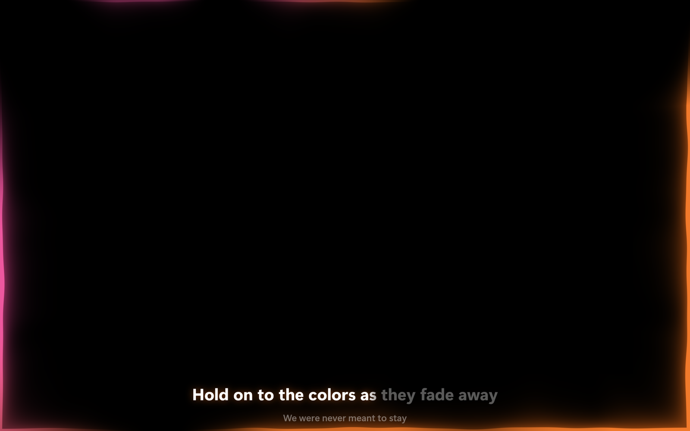
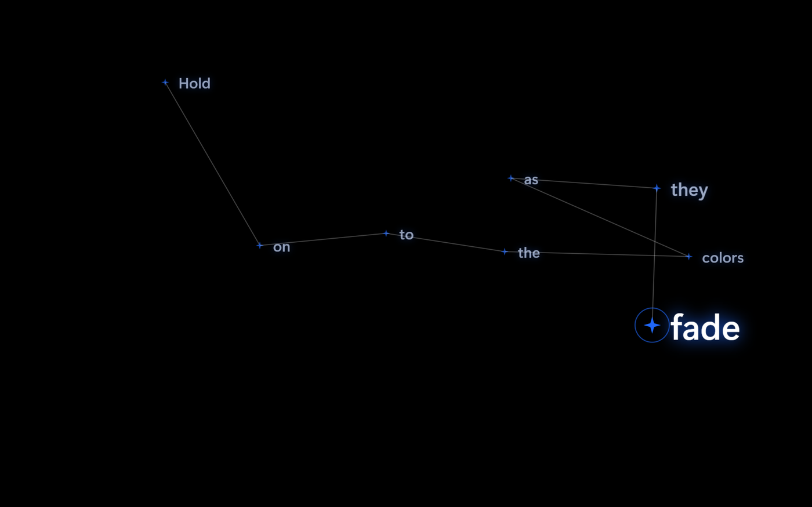
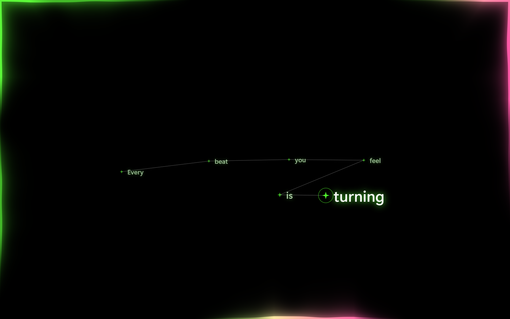
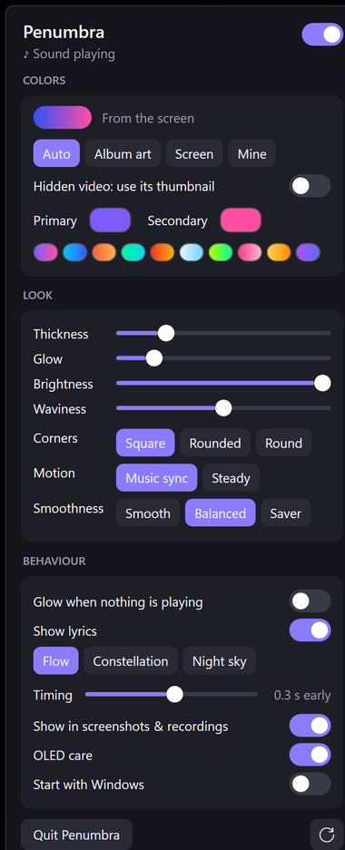

<div align="center">

# Penumbra

**An ambient light for the edges of your Windows screen.**
It moves with your music, takes its colors from what you're playing, and can show synced lyrics.



</div>

---

## Features

- **A glow that moves with the music.** A thin, solid line of light hugs the screen edges. Streams of light grow, travel around the edge and fade, with darkness in between. Beats start new streams, and louder music makes them brighter and faster.
- **Colors that match what's playing.** For music (Spotify, YouTube Music…), the glow takes the dominant color of the album art. For videos (YouTube, VLC…), it follows the colors on screen.
- **Synced lyrics, three ways:**
  - **Flow:** one big, bold line above the taskbar that fills in as it's sung, like Apple Music.
  - **Constellation:** each word appears as a star, joined to the last one.
  - **Night sky:** the constellation on a pitch-black screen, with the glow around it.
- **Stays out of your way.** Clicks go straight through it, it never takes focus, it's hidden from screenshots and screen sharing by default, and it switches itself off when nothing is playing.
- **Light on your PC.** It's drawn on the GPU and only redraws the edges. It uses about 4–8% of one CPU core while music plays, and almost nothing when it's quiet.
- **A small settings panel** that pops up from the tray icon: colors, thickness, glow, brightness, waviness, corners, smoothness, lyrics and more.

## Screenshots

<table>
<tr>
<td width="50%"><br><sub><b>Constellation</b>: the word being sung is big, earlier ones settle small</sub></td>
<td width="50%"><br><sub><b>Night sky</b>: the whole screen goes black while the song plays</sub></td>
</tr>
<tr>
<td colspan="2"><br><sub><b>Flow</b>: the line fills in white as it's sung; the next line waits below</sub></td>
</tr>
</table>



### The panel

Left-click the ring icon in the tray and the panel pops up just above it. Click anywhere else, or press Esc, and it tucks away again.

It shows what's playing and the colors in use right now, and has every setting. Changes show on screen immediately.

<br clear="right">

## Getting started

### Requirements

- **Windows 10 (version 2004 or newer) or Windows 11**
- **Python 3.10 or newer** from [python.org](https://www.python.org/downloads/). Tick "Add python.exe to PATH" when installing.
- **.NET 8 SDK:** `winget install Microsoft.DotNet.SDK.8`
- **A graphics card with Direct3D 11.** Any integrated or dedicated GPU from the last decade will do.

### Install

```powershell
git clone https://github.com/SadMan-ZaMaN/Penumbra.git
cd Penumbra
setup.bat
```

`setup.bat` creates a Python environment in `engine\.venv`, installs the Python packages, builds the app and adds **Penumbra to the Start menu and the desktop**. You only need to run it once, and again after updating the code.

### Run

| | |
|---|---|
| **Penumbra icon** | In the Start menu or on the desktop (right-click it → *Pin to taskbar* if you like). Starts Penumbra and pops up its panel; clicking it again while it's running opens the panel. |
| **`run.bat`** | Starts Penumbra. A ring icon appears in the tray. Running it again while Penumbra is running opens the panel, which is handy when Windows hides the tray icon. |
| **`stop.bat`** | Quits Penumbra (same as **Quit Penumbra** in the panel). |
| **Start with Windows** | A switch in the panel. |

Then play something: Spotify, YouTube in a browser, or any app that shows up in Windows' volume / media pop-up. The glow only shows while something is making sound. After 1.5 seconds of silence it fades out and your screen looks normal.

## Settings

| Setting | What it does |
|---|---|
| **On/off** | The switch at the top of the panel. |
| **Colors** | **Auto**: album art for music, the screen for videos. Or always **Album art**, always **Screen**, or **Mine**: pick two colors or click a preset. |
| **Hidden video: use its thumbnail** | With Auto: when a video plays minimized or behind other windows, use its thumbnail's colors instead of what's on screen. |
| **Thickness / Glow / Brightness** | The width of the line, the size of its soft halo, and overall intensity. |
| **Waviness** | How much the line's thickness ripples as the light flows. |
| **Corners** | **Square** (light reaches right into the corners), **Rounded** or **Round**. Rounded corners paint the corners outside the curve black, so the screen itself looks rounded. |
| **Motion** | **Music sync** reacts to the beat and only shows while there's sound. **Steady** is a calm light that stays on. |
| **Smoothness** | How often the glow redraws: **Smooth** (every screen refresh), **Balanced** (default; every second refresh on fast screens) or **Saver** (about 30 fps). |
| **Show lyrics** | **Flow**, **Constellation** or **Night sky**, plus a **Timing** slider if lyrics come early or late. The panel tells you whether the current song has lyrics. |
| **Show in screenshots & recordings** | Off by default. Turn it on to record the glow. |
| **OLED care** | On by default. Slowly moves the glow and lyrics a few pixels inward and back over 15 minutes, too slow to see, so the same pixels don't take all the wear. |
| **↻** | Resets the look (colors, sizes, corners, motion) to the defaults, and switches lyrics off (back to Flow). |

### Night sky

Night sky blacks out the **whole display**, taskbar included, while a song with lyrics plays. It stays black through instrumental breaks and from one song to the next, and fades back to your desktop when you pause or a song without lyrics comes on.
- **Press Esc** to lift the black: the lyrics carry on as Constellation. Esc again brings the black back, and the next song starts black again.
- **Auto-hidden taskbar?** Point at the screen edge as usual and it slides out over the black.
- Your apps keep running under the black, and clicks still reach them.
- **Safety net:** if Penumbra ever stops responding while the screen is black, the black turns see-through after 3 seconds, and Penumbra closes itself after 10 seconds.

### Now playing screen

A full-screen player: the song's cover and name on a blurred copy of the cover, with the lyrics beside it. Open it from the **Now playing screen** button at the top of the panel, or from the tray menu. **Esc** closes it, and Alt+Tab works as usual.
- Windows only gets a small cover from browsers (120 px from YouTube Music), so while this screen is open, Penumbra looks up a sharp one (1000 px) with Apple's free iTunes search. It only uses a result by the same artist with the same title, and keeps the small cover if there's none.
- Work in progress: the progress bar and play / pause / skip buttons come next.

## How it works

```
 ┌─────────── engine (Python) ───────────┐   UDP 127.0.0.1   ┌─────────── overlay (C#) ─────────────┐
 │ system audio (WASAPI loopback)        │   ~60 packets/s   │ one full-screen, click-through window │
 │   → FFT → bass / mid / high, beats    │ ────────────────► │ Direct3D 11 shader: the glow          │
 │ now playing (Windows media controls)  │                   │ Direct2D / DirectWrite: the lyrics    │
 │   music → album art  → 2 colors       │                   │ DirectComposition → the desktop       │
 │   video → the screen → 2 colors       │                   │ WPF: panel · Now playing · tray icon  │
 │ LRCLIB → synced lyrics                │                   │ starts and stops the engine           │
 └───────────────────────────────────────┘                   └───────────────────────────────────────┘
```

- **The engine** (`engine/`, Python) listens to what your speakers play (WASAPI loopback, never the microphone), and finds beats in the bass. It reads what's playing from Windows' media controls, picks two colors from the album art or the screen, and fetches synced lyrics from [LRCLIB](https://lrclib.net). It sends all of that to the overlay about 60 times a second, over UDP on `127.0.0.1` only.
- **The overlay** (`overlay/`, C#) is one transparent window covering the screen. A pixel shader (`Glow.hlsl`) works out every edge pixel's light from its distance to the edge and its position along it. Lyrics are drawn with Direct2D into the same window. The finished frames go straight to Windows' compositor through DirectComposition, so they never take a slow trip through the CPU.

**Choosing colors.** The color that covers the most of the image wins, with vivid colors counting a bit extra. Grey, black and white are ignored, so a black cover with yellow text glows yellow, and an all-black-and-white cover glows soft white. To decide between music and video:
- Music apps count as music, and video players count as video.
- In a browser, square cover art or an album name means music, and wide art means video.
- Incognito windows hide what's playing, so they use the screen's colors.

**Lyrics.** LRCLIB times whole lines, not words. Penumbra measures each song's singing pace from its lines and lights the words up at that speed.

## Performance

Measured on a 2880×1800, 90 Hz laptop with Intel Iris Xe graphics, using the built-in demo beat. CPU is in **% of one core**, so on a 16-thread CPU, divide by 16 for the share of the whole processor.

| | CPU | RAM | GPU memory |
|---|---|---|---|
| Glow, lyrics off | ~5% | ~150 MB | ~120 MB |
| Glow + Flow lyrics | ~7.6% | ~170 MB | ~150 MB |
| Glow + Constellation | ~7.1% | ~175 MB | ~150 MB |
| Glow + Night sky | ~7.0% | ~175 MB | ~150 MB |
| Nothing playing | ~1–3% | | |

Getting there took:
- A GPU-drawn window handed straight to the compositor, instead of four WPF windows. That took memory from about 500 MB to about 130 MB.
- 45 fps instead of 90.
- Drawing only the edge strips, and telling Windows which parts changed (dirty rectangles).
- Drawing each lyric word once and reusing it, instead of every frame.
- Sleeping completely when silent.

## Privacy & safety

- **Audio** is analysed in memory and never recorded or saved.
- **The screen** is sampled as a tiny 64×40 picture, only to pick video colors, and never saved or sent anywhere.
- **Lyrics:** only while **Show lyrics** is on, the song's title and artist are sent to lrclib.net to find them.
- **Covers:** only while the **Now playing screen** is open, the song's title and artist are sent to itunes.apple.com to find a sharp cover. Nothing else leaves your PC.
- **What it writes:** only `%APPDATA%\Penumbra\settings.json`, and a "start with Windows" entry if you switch that on.
- **OLED screens:** OLED care is on by default. Lower brightness and turning the glow off when you don't need it help most.
- **Games:** an always-on-top window can cost a little FPS in full-screen games, so switch the glow off while gaming.

## Troubleshooting

| Problem | Try this |
|---|---|
| I can't find the tray icon | Run `run.bat` again: it opens the panel. To keep the icon visible: Settings → Personalization → Taskbar → Other system tray icons → Penumbra. |
| No glow at all | Is something playing with sound? If the panel says "Engine not running", run `setup.bat` again. |
| No lyrics | Check the line under the lyrics settings: some songs have no synced lyrics on LRCLIB, and Incognito / private windows hide the song's title. |
| Lyrics early or late | Use the **Timing** slider. |
| The glow isn't in my recording | Turn on **Show in screenshots & recordings**. |
| Colors don't match a video | Netflix and other protected video show up as black to screen capture, so the glow keeps its previous colors. |

## Project layout

```
engine/            Python: listens, analyses, picks colors, fetches lyrics
  engine.py          main loop: audio → analysis → UDP packets
  dsp.py             FFT bands, beat detection, BPM, "is anything playing"
  media.py           now playing + album art (Windows media controls), music-or-video guess
  colors.py          image → the two colors that cover the most of it
  screen.py          samples the screen for video colors; is a window visible?
  lyrics.py          LRCLIB lookup, LRC parsing, singing-pace estimate
overlay/           C# (.NET 8): draws everything
  Program.cs         startup, single instance, engine process, Night sky safety net
  GlowWindow.cs      the click-through window, Direct3D 11 + DirectComposition, render loop
  Glow.hlsl          the glow itself (runs on the GPU)
  GlowController.cs  per-frame light: streams, smoothing, colors, beats
  LyricsRenderer.cs  lyrics: Flow, Constellation, Night sky (Direct2D)
  ControlPanel.xaml  the settings panel (+ .xaml.cs)
  NowPlayingScreen.xaml  the full-screen player (+ .xaml.cs)
  CoverLookup.cs     sharp covers from the iTunes search
  Tray.cs            tray icon and menu
  Settings.cs        settings, saved as JSON (the engine reads them too)
  Native.cs          Win32: click-through, always on top, hidden from capture, Esc watch
setup.bat · run.bat · stop.bat · debug.bat
```

## For developers

- **`debug.bat`** runs the engine in a console with live readouts: level, BPM, music or video, colors and where they came from, title and lyric line. **`debug.bat --demo`** adds a fake 120 BPM beat and made-up lyrics.
- **`Penumbra.exe --black`** draws on black instead of see-through, to judge the look. **`--no-engine`** skips starting the engine (run your own), **`--panel`** opens the panel at start-up, and **`--test-freeze`** hangs the glow during Night sky, to test the safety net.
- **Building:** `dotnet build overlay -c Release` (close Penumbra first, since the running `.exe` is locked). The shader is compiled when the app starts, so shader mistakes show up then, not at build time.
- **Tuning the feel:**
  - Beat sensitivity: `thresh` in `dsp.py`
  - Light streams: `Spawn` in `GlowController.cs`
  - Shape of the light: `width`, `halo` and `Waves` in `Glow.hlsl`

## Roadmap

- [ ] **Installer:** one setup file, with no Python or .NET to install separately
- [ ] **Hotkey** to switch the glow on and off
- [ ] **Phone / iPad sync over Wi‑Fi:** a web page that glows along with the PC and works as a remote
- [ ] Hide automatically during full-screen games
- [ ] Multi-monitor support

## Acknowledgements

- Inspired by [Lumn](https://www.trylumn.xyz/), an ambient screen light for macOS. Penumbra is an independent Windows project, not affiliated with it.
- The Constellation lyrics style was inspired by the Verci lyrics app.
- Synced lyrics come from [LRCLIB](https://lrclib.net), a free, community-run lyrics database.
- Built with [Vortice.Windows](https://github.com/amerkoleci/Vortice.Windows) (Direct3D, Direct2D and DirectComposition for .NET), [PyAudioWPatch](https://github.com/s0d3s/PyAudioWPatch), [PyWinRT](https://github.com/pywinrt/pywinrt), [NumPy](https://numpy.org) and [Pillow](https://python-pillow.org).
